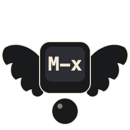
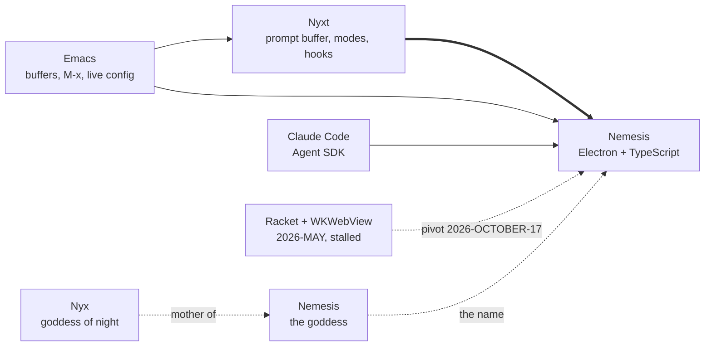
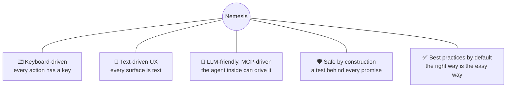
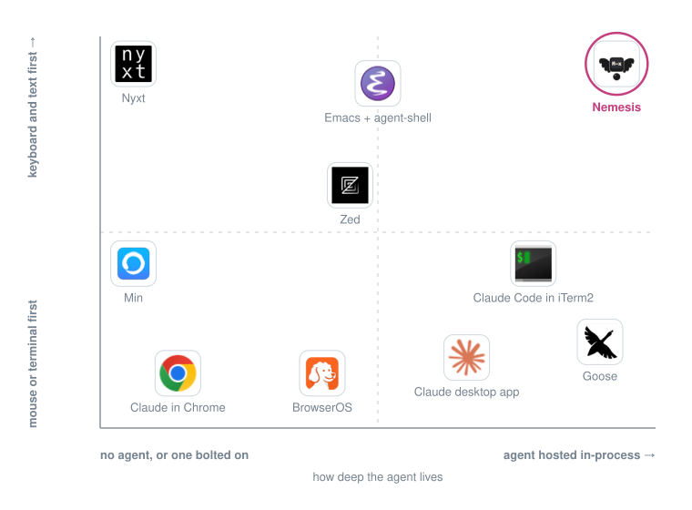
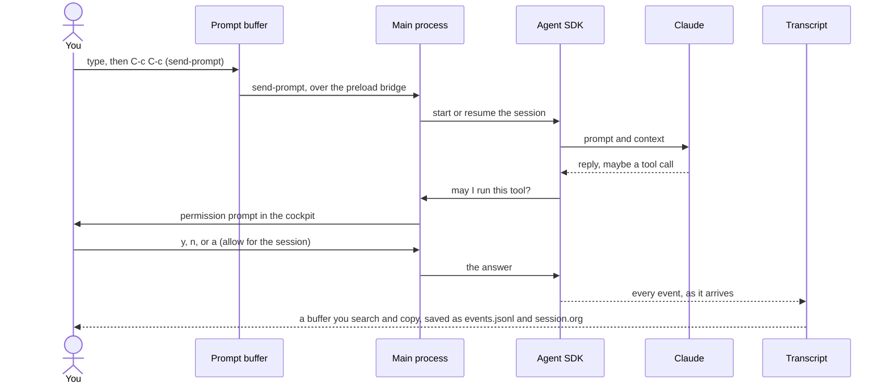
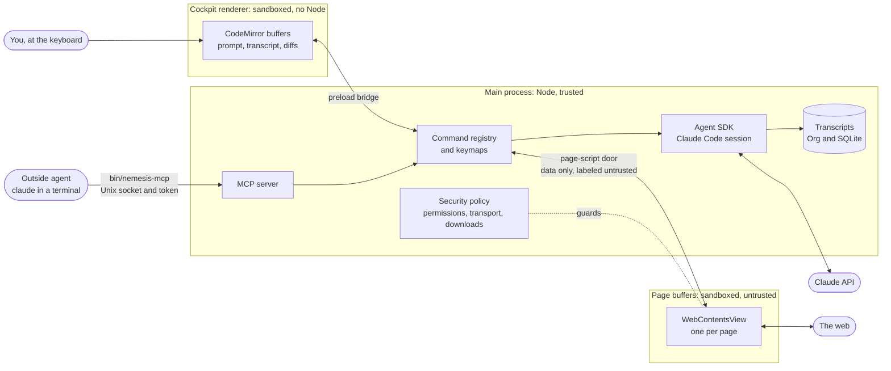
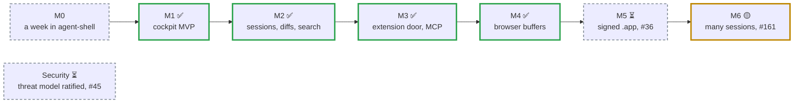

# Nemesis

_A keyboard-driven cockpit for Claude Code that grows into a browser. Daughter of Nyx._

[](https://github.com/pdelfino/nemesis/actions/workflows/ci.yml)


_Albrecht Dürer, **Nemesis (The Great Fortune)**, c. 1502. Public domain via Wikimedia Commons._



_The mark: the winged M-x key standing on Fortuna's sphere, drawn from the engraving's attributes. BSD-3-Clause like the code, not derived from Nyxt's logo. Source is `resources/logo.svg`; `node scripts/icon.mjs` regenerates every PNG size and `resources/icon.icns` from it._

## What

A desktop app for talking to Claude Code the way an Emacs user wants to: a prompt buffer with Emacs keys, a transcript that is a real text document you can search and copy from, every action a named command bound to a key, and nothing drawn through a terminal emulator. Built on Electron and TypeScript. Written for one user first, mostly by Claude Code, under rules that keep it safe.

It starts as a cockpit for Claude Code. It is designed so that a web browser in the Nyxt tradition is a later buffer type in the same codebase, not a second project.

## Heavy lineage: this is a child of Nyxt

Nemesis is **largely and extremely based on** [Nyxt](https://github.com/atlas-engineer/nyxt), the keyboard-driven, Lisp-extensible web browser by [Atlas Engineer](https://atlas.engineer/). Almost every architectural decision here starts with "what would Nyxt do?" and only diverges where the Common Lisp plus renderer-bridge stack does not translate cleanly to TypeScript running inside the renderer's own runtime.

In Greek mythology, **Nemesis is the daughter of Nyx**. So this is not a fork. It is family. Same lineage. Different platform of worship.



## Five pillars



1. **Keyboard-driven.** Every action has a keybinding. The mouse is optional, decorative, and slightly embarrassing. Like Nyxt. Like Emacs.

2. **Text-driven UX.** Every UI surface is also reachable as text: every command introspectable, every state queryable as a string, every buffer copyable as text. The prompt buffer, Nyxt's defining UX innovation, is the front door. Inspired by Emacs's "everything is a buffer".

3. **LLM-friendly and MCP-driven.** Nemesis hosts Claude Code through the official Agent SDK and exposes its own command table as a [Model Context Protocol](https://modelcontextprotocol.io) server, so the agent that lives inside it can also drive it. The thesis: a cockpit and browser purpose-built for agents, and for humans who think like agents, can do things that agent-via-extension setups structurally cannot.

4. **Safe by construction.** Untrusted web content is sandboxed by Chromium and never reaches Node. The agent treats page content as data, never as instructions. Every security control has a test that fails when the control is removed. The threat model and the non-negotiables live in [SECURITY.org](./SECURITY.org) and are read before any feature work.

5. **Best practices are the defaults.** Anthropic's [Claude Code best-practices guide](https://code.claude.com/docs/en/best-practices) is a list of things to remember: verify your work, plan before coding, be specific, keep context clean, course-correct early, review in a fresh context. Nemesis turns each one into a key, a buffer or a visible meter, so the recommended way is the easy way. The map from guideline to affordance to issue lives in [docs/guidelines-map.org](./docs/guidelines-map.org).

## Nemesis against the neighbors, honestly

Every mark below comes from the other projects' own READMEs and docs, read on 2026-OCTOBER-17 (iTerm2, Goose and Min on 2026-OCTOBER-20). Each table opens with a technical line and a plain-words line; the long version with every column is [docs/comparison.org](docs/comparison.org). Where Nemesis loses, the table says so. Hiding the bad rows is how a project earns a nemesis.

✅ yes, 🟡 partly, ❌ no.

<p align="center"></p>

_A rough reading of the tables below, not a measurement. Generated by `node scripts/positioning-map.mjs`; move a project there._

###  vs Nyxt, the parent

Nemesis is Nyxt's daughter, so this is less a rivalry than a family dinner.

|                                              | [Nyxt](https://github.com/atlas-engineer/nyxt)                                         | Nemesis                                                                                                                                      |
| -------------------------------------------- | -------------------------------------------------------------------------------------- | -------------------------------------------------------------------------------------------------------------------------------------------- |
| Technically                                  | Common Lisp browser with a prompt buffer, modes and hooks; Electron renderer since 4.0 | Electron app hosting the Claude Agent SDK in-process, CodeMirror buffers, WebContentsView page buffers, an MCP server over its command table |
| In plain words                               | A web browser you drive with the keyboard and can reprogram while it runs              | One window where you talk to Claude and browse the web with only the keyboard, and web pages cannot trick Claude                             |
| Every action is a command bound to a key     | ✅ Emacs, vi or CUA                                                                    | ✅ Emacs                                                                                                                                     |
| The prompt buffer (fuzzy M-x for everything) | ✅ invented it                                                                         | ✅ borrowed it, with thanks                                                                                                                  |
| Hints, history, bookmarks, a blocker         | ✅                                                                                     | ✅                                                                                                                                           |
| Change the app while it runs                 | ✅ a Common Lisp REPL                                                                  | ✅ `init.ts`, live reload, eval                                                                                                              |
| A coding agent inside                        | ❌                                                                                     | ✅ Claude Code, through the Agent SDK                                                                                                        |
| An MCP server, so other agents can drive it  | ❌                                                                                     | ✅ its whole command table                                                                                                                   |
| Runs on Linux                                | ✅                                                                                     | ❌ macOS for now                                                                                                                             |
| Years of daily use by strangers              | ✅ 11,000 stars                                                                        | ❌ one user, 0 stars                                                                                                                         |
| Parentheses                                  | ✅ all of them                                                                         | ❌ we are sorry                                                                                                                              |

###  vs Emacs with agent-shell

[agent-shell](https://github.com/xenodium/agent-shell) is the best Claude cockpit inside Emacs, and it is where the M0 week (#44) is lived. Nemesis exists for the part Emacs fights: a browser and a GUI that is not a terminal. Its cousin [claude-code-ide.el](https://github.com/manzaltu/claude-code-ide.el) runs the Claude CLI in a terminal inside Emacs, which is the flicker Nemesis was built to avoid. As a cockpit alone, agent-shell is the more complete tool today: the ❌ rows below are the gap, and M8 closes the first three.

|                                                | Emacs + agent-shell                                                 | Nemesis                                                                                                                                      |
| ---------------------------------------------- | ------------------------------------------------------------------- | -------------------------------------------------------------------------------------------------------------------------------------------- |
| Technically                                    | Emacs Lisp client for ACP agents, the transcript in an Emacs buffer | Electron app hosting the Claude Agent SDK in-process, CodeMirror buffers, WebContentsView page buffers, an MCP server over its command table |
| In plain words                                 | Claude inside Emacs, an old text editor you can reshape forever     | One window where you talk to Claude and browse the web with only the keyboard, and web pages cannot trick Claude                             |
| The transcript is a searchable buffer          | ✅                                                                  | ✅                                                                                                                                           |
| Approve the agent's tools from the keyboard    | ✅                                                                  | ✅                                                                                                                                           |
| Review the agent's diffs                       | ✅ accept or reject all                                             | ✅ `review-diff`, `review-apply`                                                                                                             |
| A context meter                                | ✅                                                                  | ✅ in the mode line                                                                                                                          |
| `@` file mentions, images                      | ✅ paste, screenshot, drag in                                       | ✅ paste and screenshot                                                                                                                      |
| Several sessions, each in its own git worktree | ✅                                                                  | ✅ background sessions, `fan-out`                                                                                                            |
| A web browser next to the session              | 🟡 eww, text only                                                   | ✅ Chromium page buffers                                                                                                                     |
| An MCP server over its commands                | ❌                                                                  | ✅                                                                                                                                           |
| Switch model and effort mid-session            | ✅                                                                  | ✅ `set-model`, `set-effort`, shown in the mode line                                                                                         |
| Type the next prompt while the agent works     | ✅ a queue you can edit and merge                                   | 🟡 a queue you cannot edit                                                                                                                   |
| Emacs keys                                     | ✅ the real ones                                                    | 🟡 a good impression (CodeMirror's keymap)                                                                                                   |
| Which agents                                   | ✅ 23, over ACP                                                     | 🟡 Claude only                                                                                                                               |
| Org-mode                                       | ✅ it is home                                                       | 🟡 transcripts are saved as Org, that is all                                                                                                 |
| Your configuration                             | ✅ Elisp, decades of it                                             | 🟡 TypeScript, days of it                                                                                                                    |
| Session cost on screen                         | ✅                                                                  | ❌ #191                                                                                                                                      |
| Slash command completion                       | ✅                                                                  | ❌ #192                                                                                                                                      |
| Steer a turn that is already running           | ✅                                                                  | ❌                                                                                                                                           |
| Run the agent in a container                   | 🟡 experimental                                                     | ❌                                                                                                                                           |

###  vs the Claude desktop app

Anthropic's own app. Nemesis is that idea rebuilt by someone who refuses to touch the mouse.

|                                                | Claude desktop app                                                                     | Nemesis                                                                                                                                      |
| ---------------------------------------------- | -------------------------------------------------------------------------------------- | -------------------------------------------------------------------------------------------------------------------------------------------- |
| Technically                                    | Anthropic's Electron app over Claude Code, with a sandboxed browser and cloud sessions | Electron app hosting the Claude Agent SDK in-process, CodeMirror buffers, WebContentsView page buffers, an MCP server over its command table |
| In plain words                                 | Claude's official app for coding: chat with Claude, click around with the mouse        | One window where you talk to Claude and browse the web with only the keyboard, and web pages cannot trick Claude                             |
| A browser inside                               | ✅ sandboxed, its own profile                                                          | ✅ page buffers, their own profile                                                                                                           |
| Every action a named command you can rebind    | 🟡 shortcuts                                                                           | ✅                                                                                                                                           |
| The transcript is text you can search and edit | 🟡                                                                                     | ✅                                                                                                                                           |
| Change the app at runtime                      | 🟡 CLAUDE.md, hooks, skills, plugins                                                   | ✅ `init.ts`, live reload, eval                                                                                                              |
| Other agents can drive it over MCP             | ❌ it is a client                                                                      | ✅                                                                                                                                           |
| A stated safety posture with tests behind it   | ✅ sandbox and classifiers                                                             | ✅ one spec per promise in [SECURITY.org](./SECURITY.org)                                                                                    |
| Made by the people who make Claude             | ✅                                                                                     | ❌ made by one user and Claude Code                                                                                                          |
| Signed, notarized, updates itself              | ✅                                                                                     | ❌ built from source; signing is #36                                                                                                         |

###  vs Zed

|                    | [Zed](https://zed.dev)                                            | Nemesis                                                                                                                                      |
| ------------------ | ----------------------------------------------------------------- | -------------------------------------------------------------------------------------------------------------------------------------------- |
| Technically        | GPU-rendered Rust code editor with an Agent Panel that speaks ACP | Electron app hosting the Claude Agent SDK in-process, CodeMirror buffers, WebContentsView page buffers, an MCP server over its command table |
| In plain words     | A very fast code editor with an AI helper panel                   | One window where you talk to Claude and browse the web with only the keyboard, and web pages cannot trick Claude                             |
| A key model        | ✅ vim mode and keymaps                                           | ✅ Emacs, every action a command                                                                                                             |
| A browser          | ❌                                                                | ✅                                                                                                                                           |
| MCP                | 🟡 a client                                                       | ✅ a server over its command table                                                                                                           |
| Which agents       | ✅ many, over ACP                                                 | 🟡 Claude only                                                                                                                               |
| A real code editor | ✅ a fast one, in Rust                                            | ❌ it is a cockpit; keep your editor                                                                                                         |
| Memory             | ✅ light                                                          | ❌ Electron; it eats what Electron eats                                                                                                      |
| Stars              | ✅ 91,864                                                         | ❌ 0                                                                                                                                         |

###   vs the agentic browsers

[BrowserOS](https://github.com/browseros-ai/BrowserOS) and Claude in Chrome start from autonomy: give the agent your tabs and let it click. Nemesis starts from the other end: page text is untrusted data, and every click, keystroke or navigation an agent asks for waits for your yes, one call at a time.

|                                          | BrowserOS                                                              | Claude in Chrome                                               | Nemesis                                                                                                                                      |
| ---------------------------------------- | ---------------------------------------------------------------------- | -------------------------------------------------------------- | -------------------------------------------------------------------------------------------------------------------------------------------- |
| Technically                              | Chromium fork with built-in agents and an MCP route for outside agents | Chrome extension that lets Claude drive your logged-in browser | Electron app hosting the Claude Agent SDK in-process, CodeMirror buffers, WebContentsView page buffers, an MCP server over its command table |
| In plain words                           | Chrome with AI helpers that click around web pages for you             | Claude moves the mouse in your own Chrome                      | One window where you talk to Claude and browse the web with only the keyboard, and web pages cannot trick Claude                             |
| An agent built in                        | ✅ several, local or your keys                                         | ✅ Claude                                                      | ✅ Claude Code                                                                                                                               |
| A key model                              | ❌                                                                     | ❌                                                             | ✅                                                                                                                                           |
| A page's text cannot steer the agent     | 🟡 autonomy first                                                      | 🟡 acts in live sessions                                       | ✅ labeled untrusted, with specs (T4)                                                                                                        |
| A coding agent in your repo, same window | ❌                                                                     | ❌                                                             | ✅                                                                                                                                           |
| A full browser                           | ✅ a Chromium fork                                                     | ✅ your own Chrome                                             | 🟡 page buffers: no extensions, no password manager                                                                                          |
| The agent clicks in your logged-in tabs  | ✅                                                                     | ✅ that is the point                                           | 🟡 only with your yes, per click                                                                                                             |

###  vs Claude Code in iTerm2, the daily baseline

This is what Nemesis replaces every day, so it is a key reference: if Nemesis does not feel better than this, it has failed.

|                                       | Claude Code in [iTerm2](https://iterm2.com)                                                  | Nemesis                                                                                                                                      |
| ------------------------------------- | -------------------------------------------------------------------------------------------- | -------------------------------------------------------------------------------------------------------------------------------------------- |
| Technically                           | The Claude Code Node CLI drawing its terminal UI in iTerm2, a native macOS terminal emulator | Electron app hosting the Claude Agent SDK in-process, CodeMirror buffers, WebContentsView page buffers, an MCP server over its command table |
| In plain words                        | Talking to Claude in a black text window, the way programmers type commands                  | One window where you talk to Claude and browse the web with only the keyboard, and web pages cannot trick Claude                             |
| Every Claude Code feature, first-hand | ✅ skills, hooks, plugins, /resume                                                           | 🟡 through the SDK, same settings files                                                                                                      |
| Keys                                  | 🟡 readline and iTerm shortcuts                                                              | ✅ Emacs keyscheme, every command bound                                                                                                      |
| The transcript is text you can edit   | 🟡 scrollback; copy grabs junk                                                               | ✅ a real buffer                                                                                                                             |
| Web pages next to the session         | ❌                                                                                           | ✅ page buffers                                                                                                                              |
| Other agents can drive it over MCP    | ❌                                                                                           | ✅                                                                                                                                           |
| Rock solid                            | ✅ years of it                                                                               | 🟡 a stable channel since 2026-OCTOBER-20                                                                                                    |

###  vs Goose

[Goose](https://github.com/aaif-goose/goose) is the other key reference: the strongest open-source agent platform, now under the Linux Foundation. The full study is #183.

|                                         | Goose                                                                                            | Nemesis                                                                                                                                      |
| --------------------------------------- | ------------------------------------------------------------------------------------------------ | -------------------------------------------------------------------------------------------------------------------------------------------- |
| Technically                             | Rust agent loop over 15+ model providers, Electron desktop and CLI, MCP extensions, YAML recipes | Electron app hosting the Claude Agent SDK in-process, CodeMirror buffers, WebContentsView page buffers, an MCP server over its command table |
| In plain words                          | A free AI helper that works with any AI brand and plugs into tools, for code or anything else    | One window where you talk to Claude and browse the web with only the keyboard, and web pages cannot trick Claude                             |
| Which models                            | ✅ any, 15+ providers                                                                            | 🟡 Claude only                                                                                                                               |
| Claude Code as the engine               | 🟡 through ACP, no resume yet                                                                    | ✅ the Agent SDK, in-process                                                                                                                 |
| Saved workflows, scheduled and headless | ✅ recipes                                                                                       | ❌ not yet (ported from Goose, #183)                                                                                                         |
| A key model                             | 🟡 a shortcut list                                                                               | ✅                                                                                                                                           |
| A browser                               | ❌ only through extensions                                                                       | ✅                                                                                                                                           |
| Asks before acting, by default          | ❌ Autonomous is the default                                                                     | ✅                                                                                                                                           |
| Community                               | ✅ 55,000 stars, weekly releases                                                                 | ❌ one user                                                                                                                                  |

###  vs Min

[Min](https://github.com/minbrowser/min) is the closest browser on the same stack, and the proof that a daily Electron browser is realistic.

|                                        | Min                                                                                          | Nemesis                                                                                                                                      |
| -------------------------------------- | -------------------------------------------------------------------------------------------- | -------------------------------------------------------------------------------------------------------------------------------------------- |
| Technically                            | Electron browser in plain JavaScript, a WebContentsView per tab, blocker and reader built in | Electron app hosting the Claude Agent SDK in-process, CodeMirror buffers, WebContentsView page buffers, an MCP server over its command table |
| In plain words                         | A simple, clean web browser that blocks ads and hides clutter                                | One window where you talk to Claude and browse the web with only the keyboard, and web pages cannot trick Claude                             |
| Ads and trackers blocked               | ✅                                                                                           | ✅                                                                                                                                           |
| Full-text search of your history       | ✅                                                                                           | ❌ not yet                                                                                                                                   |
| Password manager                       | ✅ Bitwarden, 1Password, KeePassXC                                                           | ❌ on purpose: banking stays in Brave                                                                                                        |
| A key model                            | 🟡 about 35 remappable shortcuts                                                             | ✅                                                                                                                                           |
| An agent inside                        | ❌                                                                                           | ✅                                                                                                                                           |
| The app's own UI is isolated from Node | ❌ nodeIntegration on                                                                        | ✅ every renderer sandboxed                                                                                                                  |
| Years of daily users                   | ✅                                                                                           | ❌                                                                                                                                           |

### So, should you use it?

Use something else if you want many agents (Zed, agent-shell), you live happily in Emacs (agent-shell), you want a signed app from Anthropic (the desktop app), or you need Linux or a battle-tested browser (Nyxt, or any big one). Use Nemesis if you want Claude Code, a browser and Emacs keys in one keyboard-driven window that other agents can drive over MCP, with a test behind every safety promise. It is young and has exactly one user. You could be the second.

## Why the cockpit first

The daily pain is talking to Claude Code. iTerm2 is stable but cannot be customized the way Emacs can. Emacs has the bindings, but hosting the Claude Code terminal UI inside a terminal emulator flickers, breaks scrolling, and fights the display engine. Nemesis never runs the terminal UI at all: it drives Claude Code headless through the SDK and draws the conversation itself.

A prompt's journey, from your keys to the transcript:



The cockpit's core, buffers, a prompt buffer, keymaps and a command registry, is also half of a Nyxt-style browser. Building the first builds the second.

## Why TypeScript and Electron

Picked by ecosystem, not taste.

- The [Claude Agent SDK](https://platform.claude.com/docs/en/agent-sdk/overview) is first-party TypeScript and runs in the Electron main process as a library. Permissions, hooks, sessions, resume and subagents come without an adapter to maintain.
- Chromium is the rendering engine, so a browser is a buffer type away, and the Chrome DevTools Protocol lets Claude Code launch, drive and test the app it builds.
- [CodeMirror 6](https://codemirror.net/) is every text surface, with a mature Emacs keymap.
- TypeScript has the largest corpus of anything an agent writes. Electron and CodeMirror are a decade old and documented to death. Boring is a feature.

What this rules out, knowingly: the deepest macOS integration (Swift with AppKit reaches further) and a small memory footprint. Accepted.

## Stack

| Layer         | Choice                                                     |
| ------------- | ---------------------------------------------------------- |
| Shell         | Electron, current stable, bumped deliberately              |
| Language      | TypeScript, strict                                         |
| Text surfaces | CodeMirror 6 with the Replit Emacs keymap                  |
| Agent         | Claude Agent SDK (TypeScript) in the main process          |
| Storage       | Org transcripts on disk, SQLite via node:sqlite (built in) |
| Tests         | Vitest for units, Playwright for Electron end to end       |
| Build         | electron-vite, electron-builder for the `.app`             |
| Agent door    | MCP server over stdio exposing the command table           |

How the pieces fit, and where the trust boundaries are (ADR 0007, ADR 0008, ADR 0009, [SECURITY.org](./SECURITY.org)):



## Safety posture, in one paragraph

Nemesis is not an anonymity browser and will never claim to be one. Its promise is narrower and testable: a malicious page cannot escape Chromium's sandbox into the app, downloads are opt-in and quarantined, transport is HTTPS-only, permissions are denied by default, the agent cannot be steered by text it reads on a page, dependencies are pinned and audited, and the engine is updated within a week of a Chromium security release. Banking and other high-value accounts stay in Brave or Safari until Nemesis is signed, notarized, and has shipped engine updates on time for three months. Details in [SECURITY.org](./SECURITY.org).

## Status

As of 2026-OCTOBER-20, main carries:

- **M1 and M2, the cockpit:** the prompt buffer with Emacs keys, the transcript as a document, permissions answered from the keyboard, the M-x palette, sessions with names and resume, diff buffers, search across transcripts, the context meter, rewind, plan mode as a buffer, the environment panel, multiple windows and notifications when a session finishes or needs you.
- **M3, the extension door:** `init.ts` with live reload, eval, a worktree per window, `review-diff` in a fresh session, and the MCP server over the command table.
- **M4, the browser:** page buffers, hints, history and bookmarks, the blocker, reader mode, the form guide, quarantined downloads, session restore, and the MCP page tier (`browser_` tools, each action asked once per call).
- **M5, distribution:** a local unsigned `.app`; signing and notarization are ready and wait on a Developer ID (#36).
- **M6, many sessions on one screen:** the `agents` buffer (`C-x 5 a`), background sessions, `send-to-session` and `fan-out`. What an outside agent may see of them over MCP waits on a pick (#161).

`make gate` (unit, end to end and security specs) runs before every commit, and `make real` drives the real Agent SDK with Haiku. Where the work stands for the next session is [docs/handoff.org](docs/handoff.org).

## Development setup

New here? [docs/getting-started.org](docs/getting-started.org) is the first fifteen minutes: install, the first prompt, page buffers and your first `init.ts`.

- Node 24 LTS through nvm (`.nvmrc`), npm with a committed lockfile.
- `make setup` then `make dev` opens the window; `make gate` runs the gate; bare `make` lists the targets. Underneath: `make setup` checks Node against `.nvmrc` (through nvm when present) and runs `npm ci --ignore-scripts` and `node node_modules/electron/install.js`, `make dev` is `npm run dev` with `NEMESIS_USER_DATA` set to `~/Library/Application Support/Nemesis-dev`, so it never shares data with an installed `Nemesis.app` (and runs setup first on a fresh clone), `make gate` is `npm run gate` (dependency check, typecheck, lint, unit, end-to-end and security specs). The gate runs locally before every commit; GitHub Actions is the second opinion at ready-for-review. A red end-to-end spec leaves a screenshot and the main-process log under `test-results/`.
- `make app` (`npm run package`) builds a local, unsigned `release/mac-arm64/Nemesis.app` with electron-builder: fuses flipped and the binary re-signed ad hoc so Apple silicon runs it, the Agent SDK's CLI binary unpacked from the asar. It is about 550 MB, of which about 256 MB is that CLI binary and 288 MB the Electron framework; the app code in `app.asar` is about 5 MB. `npx playwright test --project=package` launches it, reads its fuses back and checks the unpacked binary. Signing and notarization are #36.
- `npm run dev:debug` opens the window with a loopback DevTools port on 9222, and `npm run peek` reads the window through that port (title, mode line, buffer text, a PNG). See CONTRIBUTING.org.
- Claude Code reads `CLAUDE.md` at the root. The non-interactive queue reads `.claude-queue`.

## Connecting an outside agent (MCP)

A running Nemesis serves its cockpit through MCP, so a `claude` in a terminal, or any other client, drives it the way a user does and under the same rules (ADR 0007 and ADR 0008). The client spawns `bin/nemesis-mcp`, a few lines of plain Node that find the socket in the app's user data folder, present the run's token and forward bytes; it never starts the app, so open Nemesis first. The catalog is eight `cockpit_` tools: listing and running commands, listing and reading buffers, sending a prompt, searching transcripts, the session's info and its name. Reads answer at once; sending a prompt, naming the session and running a command that changes something ask you in the prompt buffer first, with the client's name in the question and the no highlighted. From the checkout:

```sh
claude mcp add --scope local nemesis -- node <checkout>/bin/nemesis-mcp
```

The catalog has since grown a page tier (`browser_` tools, three feeds per page buffer). [docs/mcp.org](docs/mcp.org) is the full guide: connecting Claude Code or Claude Desktop, every tool with its confirmation class, the label rule for page text and what never exists.

## Roadmap



| Milestone | Outcome                                                                                    |
| --------- | ------------------------------------------------------------------------------------------ |
| M0        | A week in agent-shell. Notes on what a cockpit needs. No code.                             |
| Security  | Hardening baseline and security suite done; the threat model waits on ratification (#45).  |
| M1 (done) | Cockpit MVP: one window, prompt buffer, transcript, permissions, M-x, transcripts on disk. |
| M2 (done) | Sessions and resume, diff buffers, search across transcripts.                              |
| M3 (done) | Extension door: user config, live reload, eval, MCP server over the command table.         |
| M4 (done) | Browser buffers in the Nyxt tradition: prompt buffer over URLs, hints, history, blocker.   |
| M5        | Distribution: signed and notarized `.app`, update policy. Waits on a Developer ID (#36).   |
| M6        | Many sessions, one screen: agents buffer, background sessions, send-to-session, fan-out.   |

## History

- 2026-MAY-02: born as a Racket-native, macOS-only browser over WKWebView through an Objective-C bridge. Phase 0 scaffolding landed through claude-queue. The plan stalled before the FFI spike that was its go or no-go gate.
- 2026-OCTOBER-17: pivot to TypeScript and Electron, cockpit first, after a long design review of Emacs, Nyxt, agent-shell, Pel, llm-lang and Pille. Racket-era issues 1 to 41 stay for the record; superseded ones are closed with a pointer to #43.

## Repos and documents to study

### Projects

The same projects as the rows of [docs/comparison.org](docs/comparison.org), no more and no fewer; add or remove a project in both files in the same commit. The two key references come first.

| Project                                                                                                                                                   | Why                                                                                     |
| --------------------------------------------------------------------------------------------------------------------------------------------------------- | --------------------------------------------------------------------------------------- |
|  [Claude Code in iTerm2 (key reference)](https://docs.claude.com/en/docs/claude-code/overview) | The daily baseline Nemesis has to beat on feel                                          |
|  [aaif-goose/goose (key reference)](https://github.com/aaif-goose/goose)                        | Strongest open-source agent platform: recipes, ACP providers, adversary reviewer (#183) |
|  [atlas-engineer/nyxt](https://github.com/atlas-engineer/nyxt)                                   | Architectural source of truth: prompt buffer, modes, hooks, keymaps, history            |
|  [xenodium/agent-shell](https://github.com/xenodium/agent-shell)                                | The reference Claude cockpit inside Emacs; M0 lives here                                |
|  [manzaltu/claude-code-ide.el](https://github.com/manzaltu/claude-code-ide.el)                  | Emacs as an MCP tool server for Claude                                                  |
|  [Claude Code desktop app](https://claude.com/download)                                        | The official cockpit: sessions, sandboxed browser, classifiers                          |
|  [zed-industries/zed](https://github.com/zed-industries/zed)                                      | Agent Panel over ACP and a fast key model                                               |
|  [winfunc/opcode](https://github.com/winfunc/opcode)                                           | GUI over the Claude CLI: custom agents, usage tracking                                  |
|  [BloopAI/vibe-kanban](https://github.com/BloopAI/vibe-kanban)                            | Agents per task in worktrees, an MCP task server                                        |
|  [smtg-ai/claude-squad](https://github.com/smtg-ai/claude-squad)                         | Many Claude Code sessions in tmux and worktrees                                         |
|  [Conductor](https://conductor.build)                                                       | Mac app for parallel agents per worktree                                                |
|  [minbrowser/min](https://github.com/minbrowser/min)                                              | Proof that a daily-use browser on Electron is realistic                                 |
|  [glide-browser/glide](https://github.com/glide-browser/glide)                                  | Modal keys and a TypeScript config door on Firefox                                      |
|  [qutebrowser/qutebrowser](https://github.com/qutebrowser/qutebrowser)                    | Keyboard-only browsing done well for years                                              |
|  [browseros-ai/BrowserOS](https://github.com/browseros-ai/BrowserOS)                        | Agentic browser with an MCP route; what autonomy-first looks like                       |
|  [Claude in Chrome](https://claude.com/chrome)                                                 | Claude driving a logged-in browser; the threat Nemesis designs against                  |
|  [browsermcp/mcp](https://github.com/browsermcp/mcp)                                       | MCP tool-surface reference for M3 and M4; match then exceed                             |

### Documents

| Document                                                                                | Why                                            |
| --------------------------------------------------------------------------------------- | ---------------------------------------------- |
| [Claude Agent SDK](https://platform.claude.com/docs/en/agent-sdk/overview)              | The agent runtime Nemesis hosts                |
| [Electron security checklist](https://www.electronjs.org/docs/latest/tutorial/security) | Every item is a non-negotiable in SECURITY.org |
| [docs/comparison.org](docs/comparison.org)                                              | One table: Nemesis next to every project above |

## License

BSD-3-Clause. Matches Nyxt's license, in case anything is ever ported between the projects in either direction.
